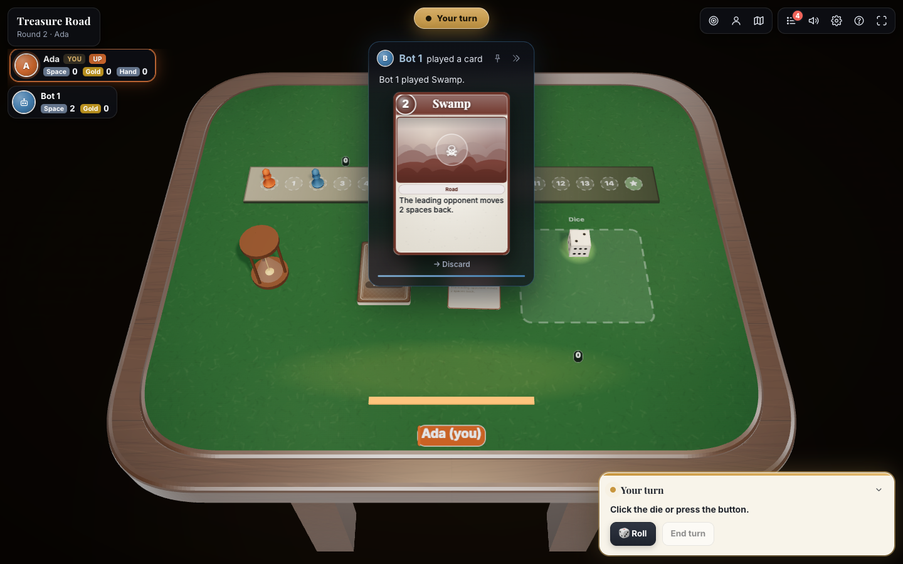

<p align="center">
  
</p>

<h1 align="center">Tablecraft</h1>

<p align="center">
  <b>Write the rules. Get the table.</b><br />
  A server-authoritative 3D tabletop engine: describe any board or card game in one JavaScript module and get a
  physics-based table with multiplayer rooms, bots and an automated referee.
</p>

<p align="center">
  <a href="https://www.npmjs.com/package/tablecraft"></a>
  <a href="https://github.com/table-craft/table-craft/actions/workflows/ci.yml"></a>
  
  <a href="LICENSE"></a>
  
</p>

<p align="center">
  <a href="https://table-craft.github.io/table-craft/">Live demo</a> ·
  <a href="https://table-craft.github.io/table-craft/playground.html">Playground</a> ·
  <a href="https://table-craft.github.io/table-craft/examples.html">Examples</a> ·
  <a href="docs/getting-started.md">Getting started</a> ·
  <a href="https://table-craft.github.io/table-craft/docs/">Documentation</a>
</p>

<p align="center">
  
</p>

---

## Why Tablecraft

Prototyping a tabletop game online usually means choosing between a spreadsheet-like UI that nobody enjoys and months
of game-engine work. Tablecraft sits in between: **you write the rules, it builds the table.**

- **One file per game.** `setup()`, `moves`, `view()`, `endIf()`. State is plain JSON; randomness is seeded and replayable.
- **A real table.** Cards arc, tilt and flip; dice are thrown with physics and land on the server's result; tokens toss and stack.
- **Fair by construction.** Moves run on the host in a sandbox. Each player's `view()` contains only what they may see.
- **Bots and a referee for free.** Export `actions()` and bots can play; the referee plays hundreds of games and reports rule bugs.
- **Mechanics in the box.** Drafting, auctions, worker placement, majorities, trick-taking, set collection, deck-building,
  decision stacks, square and hex grids — [40+ mechanics](docs/mechanics.md) as small, deterministic helpers on `T`.
- **Balance you can measure.** The balance lab reports first-player advantage, game length, forced decisions, comebacks and dominant strategies — and sweeps a card count or point value to show what a change would do.
- **Followable.** The Spotlight puts every card another player reveals or plays on stage; the game log keeps the whole story.
- **Play anywhere.** In the browser against bots (no server), or on your own socket.io room server for real multiplayer.
- **Typed.** Hand-written TypeScript declarations: autocomplete for the module contract, the scene and `T` — even in plain JS.
- **AI-ready.** `npx tablecraft mcp` gives Claude (or any MCP client) tools to write, referee, audit and step through games.

## 60-second start

```bash
npm create tablecraft@latest my-game     # templates: dice (default), cards, multiplayer
cd my-game && npm install && npm run dev
```

Or try it without installing anything in the [playground](https://table-craft.github.io/table-craft/playground.html):
edit a game on the left, play it on the right, run the referee and the balance lab, share a link.

### Add it to an existing app

```bash
npm install tablecraft react react-dom three cannon-es
```

```jsx
import { createLocalMatch } from 'tablecraft';
import { TablecraftGame } from 'tablecraft/react';
import 'tablecraft/style.css';
import source from './treasure-road.js?raw'; // any game module, as text

const match = createLocalMatch({ source, players: ['Ada', 'bot', 'bot'] });

export default function App() {
  return <TablecraftGame client={match} style={{ height: '100vh' }} />;
}
```

Copy [`examples/treasure-road/game.js`](examples/treasure-road/game.js) next to it and you are playing a 3D card-and-dice
race against two bots. When you want friends at the table, swap one line:

```js
import { io } from 'socket.io-client';
import { connectRoom } from 'tablecraft';

const match = connectRoom({ io, url: 'https://your-server', room: 'AB12CD', name: 'Ada' });
```

…and run a room server ([full example](examples/server/server.js)):

```js
import { createRoomServer } from 'tablecraft/server';

const rooms = createRoomServer(io.of('/tablecraft'));
const code = rooms.createRoom({ source: fs.readFileSync('game.js', 'utf8') });
```

## What a game looks like

```js
module.exports = {
  meta: { name: 'Treasure Road', minPlayers: 1, maxPlayers: 4 },

  setup({ players, random }) {
    return { players: players.map((p) => ({ ...p, pos: 0 })), turn: 0, log: [] };
  },

  moves: {
    roll(s, ctx) {
      if (s.players[s.turn].id !== ctx.playerId) return { error: 'Not your turn' };
      const r = ctx.roll(6, { id: 'die', by: ctx.playerId }); // 3D die lands on r
      s.players[s.turn].pos += r.face;
      s.turn = T.nextIndex(s.players.length, s.turn);          // T = the rules kit
      return s;
    },
  },

  view(s, { playerId }) {
    return {
      type: 'tabletop',
      scene: {
        zones: [{ id: 'track', layout: 'track', cells: 16, at: [-30, 0], to: [60, 0] }],
        objects: [
          { id: 'die', kind: 'die', at: [0, 10], click: { name: 'roll' } },
          ...s.players.map((p) => ({ id: p.id, kind: 'token', shape: 'pawn', zone: 'track', order: p.pos })),
        ],
      },
      hud: { title: 'Treasure Road', log: s.log },
    };
  },

  endIf: (s) => (s.players.some((p) => p.pos >= 15) ? { reason: 'Someone found the treasure' } : null),
  actions: (s, { playerId }) => (s.players[s.turn].id === playerId ? [{ name: 'roll' }] : []),
};
```

Most games are built from the same mechanics, so the kit has them — a trick-taking hand is a few lines:

```js
const legal = T.tricks.legal(me.hand, s.trick, { trump: s.trump });   // follow suit if you can
s.leader = T.tricks.winner(s.trick, { trump: s.trump }).id;            // highest trump, else highest of the suit led
// ...and at the end: a ranking with tie-breakers, ready for endIf
return T.score.result(s.players, { keys: ['score', '-penalties'] });
```

## Packages in the box

| Import | What it is |
|---|---|
| `tablecraft` | Isomorphic core: `createLocalMatch`, `connectRoom`, `Match`, the rules kit `T`, referee, seeded RNG |
| `tablecraft/react` | `<TablecraftGame>` (lobby + table + end screen), `<Tabletop>`, `useMatch()` |
| `tablecraft/embed` | `mountGame(element, props)` for pages without React code |
| `tablecraft/engine` | The framework-free three.js table (`TabletopWorld`) for custom UIs |
| `tablecraft/server` | Node: `node:vm` runtime, `createRoomServer`, referee (`simulate`, `validate`), balance lab (`analyzeBalance`, `sweepParameter`), view `audit`, worker-thread variants (`simulateAsync`, `analyzeBalanceAsync`) |
| `tablecraft/style.css` | HUD styles (themeable with `--tc-*` custom properties) |
| `tablecraft/game` | Types only: `/// <reference types="tablecraft/game" />` in a game file gives autocomplete for `T`, `ctx` and the scene |
| `tablecraft/mcp` · `npx tablecraft mcp` | MCP server for AI assistants; `npx tablecraft validate / simulate / audit` from the terminal |

## Documentation

| | |
|---|---|
| [Getting started](docs/getting-started.md) | Your first game, locally, in ten minutes |
| [Concepts](docs/concepts.md) | Host, views, intents, fx — the mental model |
| [Game module](docs/game-module.md) | `meta`, `setup`, `moves`, `view`, `endIf`, `actions`, `bot`, `invariants`, `ctx` |
| [Scene](docs/scene.md) | Zones, layouts, cards, decks, dice, tokens, boards, timers, faces and art |
| [HUD](docs/hud.md) | Players, prompts, panels, log and 2D UI nodes |
| [Effects](docs/fx.md) | Dice, banners, toasts, sounds, tosses, highlights, reveals |
| [Rules kit `T`](docs/rules-kit.md) | Decks, turn order, resources, sand timers, graphs, hex grids |
| [Mechanics](docs/mechanics.md) | A catalog of 40+ board-game mechanics and the helpers that implement them |
| [Following the game](docs/following-the-game.md) | Spotlight, game log, pacing — and how to write games that read well |
| [Client](docs/client.md) | React, embed, engine, theming, locales, keyboard |
| [Server](docs/server.md) | Room server, wire protocol, hosting, security |
| [Bots & referee](docs/testing.md) | `actions()`, `bot()`, `invariants()`, `simulate()` in CI |
| [Balance lab](docs/balance.md) | Is it fair? First-player advantage, length, forced decisions, comebacks, dominant strategies, sweeps |
| [AI assistants (MCP)](docs/mcp.md) | Connect Claude Code / Claude Desktop; tools, resources, prompts |

## Examples

| Game | Players | Shows |
|---|---|---|
| [Coin Flip Duel](examples/coin-flip-duel/game.js) | 2 | the 40-line game from Getting started |
| [Treasure Road](examples/treasure-road/game.js) | 1–4 | hidden hands, deck and discard, physical die, sand timer |
| [Supply Lines](examples/supply-lines/game.js) | 2–4 | hex map, routes between corners, path finding |
| [Spice Bazaar](examples/spice-draft/game.js) | 2–5 | simultaneous drafting, set collection, majorities |
| [Harbor Workers](examples/harbor-workers/game.js) | 2–4 | worker placement, phases, sliding market, decision stack |
| [Auction House](examples/auction-house/game.js) | 3–5 | open, once-around, sealed and Dutch auctions, hidden money |
| [Drop Four](examples/four-in-a-row/game.js) | 2 | square grid, n-in-a-row (`T.grid.lineRuns`), a bot that wins and blocks |
| [Liar's Dice](examples/liars-dice/game.js) | 2–5 | private dice rolls, bluffing, bots that bid with exact odds |
| [Lantern Tricks](examples/tricks/game.js) | 3–4 | trick-taking with trumps and exact bids (`T.tricks`, `T.flow`) |
Every example passes `npx tablecraft simulate` and `audit` in CI. Play them all in the [gallery](https://table-craft.github.io/table-craft/examples.html).

## How it compares

| | Tablecraft | boardgame.io | Tabletop Simulator |
|---|---|---|---|
| Rules enforced by the server | ✅ | ✅ | ❌ (sandbox, optional Lua) |
| 3D table with physics dice and cards | ✅ built in | ❌ bring your own UI | ✅ |
| Hidden information per player | ✅ `view()` | ✅ `playerView` | manual (hidden zones) |
| Bots from your rules | ✅ `actions()` + heuristics | ✅ MCTS | ❌ |
| Automated referee and balance metrics | ✅ | ❌ | ❌ |
| Board-game mechanics library | ✅ `T` | ❌ | ❌ |
| AI assistant tools (MCP) | ✅ | ❌ | ❌ |
| Price / license | free, MIT | free, MIT | paid, closed |

Pick boardgame.io if you want full control over a 2D React UI; pick Tabletop Simulator to play existing games freely
with friends. Tablecraft is for designers who want a rules-enforcing, playable, testable table from one file.

## Develop

```bash
npm install
npm test             # runtime, mechanics, referee, match, scaffolder and an end-to-end socket.io room
npm run lint         # ESLint
npm run typecheck    # the TypeScript declarations in types/
npm run site:dev     # landing page + playground at http://localhost:5173
npm run example:server
npm run build        # dist/ for npm
```

Node ≥ 22.12 (the server entry is ESM and also loads with `require()`). Browsers: anything with WebGL 2.

### Docker

```bash
docker build --target site  -t tablecraft-site .     # landing + playground, static on nginx :80
docker build --target rooms -t tablecraft-rooms .    # room server :5180 (GAME=examples/coin-flip-duel/game.js)
docker run -p 5180:5180 tablecraft-rooms             # → http://localhost:5180/?room=<code from the log>
```

## Origin

Tablecraft was extracted from the 3D playtest table of an AI board-game studio, where hundreds of machine-written
prototypes needed a table that was fair, readable and fun to watch.

## Community

- Questions, ideas and games you made: [Discussions](https://github.com/table-craft/table-craft/discussions)
- Bugs and feature requests: [Issues](https://github.com/table-craft/table-craft/issues)
- How to contribute: [CONTRIBUTING](CONTRIBUTING.md) · where we are going: [ROADMAP](ROADMAP.md)
- Security reports: [SECURITY](SECURITY.md) · be kind: [Code of conduct](CODE_OF_CONDUCT.md)

## License

[MIT](LICENSE)
